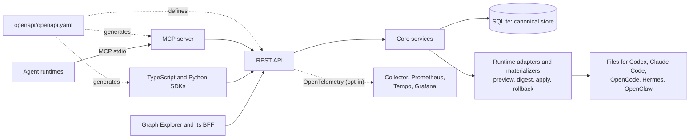

# Portable Agent Asset Hub

[](https://github.com/dcosodev/portable-agent-asset-hub/actions/workflows/ci.yml)
[](LICENSE)

**The problem in one sentence:** every AI coding agent (Claude Code, Codex,
Cursor-likes, custom bots) wants your reusable knowledge — skills,
instructions, memories — in its own file format, in its own directory, so
the same knowledge ends up copy-pasted and drifting across five tools with
no single place that says which copy is right. This project keeps one
versioned, audited copy and generates each tool's format from it on demand.

## What it is

A local hub, written mainly in TypeScript, with a thin Go CLI. Assets live once in
SQLite. One OpenAPI contract drives a REST API, an MCP stdio server, and
TypeScript and Python SDKs. Adapters attach the hub to Codex, Claude Code,
OpenCode, Hermes and OpenClaw under one lifecycle: preview, digest, apply,
rollback. Each runtime's files are generated from the hub, so adding a runtime
means writing a renderer, not another source of truth.

It also includes a versioned skill graph with bounded retrieval, a reviewed
workflow for proposing relations between skills, a web Graph Explorer, and
opt-in OpenTelemetry. It is a portfolio and research project, not a hosted service.

## Quick start

You need Node `>=22.16` and pnpm `11.0.8`. Go is needed only for the `hub` CLI and
its tests. The steps below need no network after `pnpm install`.

```sh
pnpm install --frozen-lockfile
pnpm build

# Profile -> preview -> apply -> drift rejected with 412 -> rollback.
# Uses a throwaway database and target directory.
node examples/demo/demo.mjs

# Start a hub on a temporary database, on 127.0.0.1:39421, with no token.
pnpm hub:start:temp

# In another terminal.
curl -s http://127.0.0.1:39421/api/v1/health
# {"ok":true}
```

[`docs/demo.md`](docs/demo.md) walks through the demo step by step and shows the
SDKs. [`docs/faq.md`](docs/faq.md) explains the warnings you may see, including the
`node:sqlite` experimental warning, which is expected.

## Architecture at a glance



Only `packages/storage-sqlite` opens the database, and nothing else is a source of
truth. A stale digest stops an apply. Telemetry is off by default, and no behaviour
depends on it. See [`docs/architecture.md`](docs/architecture.md).

## Project status

The current version is in [`CHANGELOG.md`](CHANGELOG.md). What exists is described
in [What ships](docs/architecture.md#what-ships).

It does not include:

- a hosted service, a managed runtime, or any SLA;
- a persistent log store;
- automatic approval of relations: human review is the only path to a canonical
  relation;
- anyone's private skills, profiles, tokens, sessions or runtime data. The fixture
  under `docs/baseline/public-fixture/` is neutral example data.

## Validation

CI runs the documentation check, lint, typecheck, tests, OpenAPI drift detection,
static observability and Docker checks, MCP metadata reproducibility, and the demo.
This is what is currently enforced.

```sh
pnpm docs:check && pnpm lint && pnpm typecheck && pnpm test
```

The repository also has longer local gate scripts, which CI does not run and which
are not all green at present. [`docs/validation.md`](docs/validation.md) lists every
command and what it covers.

## Documentation

- [`docs/README.md`](docs/README.md): index of all documents.
- [`docs/architecture.md`](docs/architecture.md): system map, subsystems and what ships.
- [`docs/api-surface.md`](docs/api-surface.md): every operation, with its safety class.
- [`docs/packages.md`](docs/packages.md): packages and repository layout.
- [`docs/runtime-adapters.md`](docs/runtime-adapters.md): attaching a hub to a runtime.
- [`docs/architecture/go-product-shell.md`](docs/architecture/go-product-shell.md): the `hub` CLI.
- [`docs/adr/`](docs/adr/): architecture decision records.
- [`docs/archive/`](docs/archive/README.md): how the project was built. Historical only.

## Contributing, security and license

See [`CONTRIBUTING.md`](CONTRIBUTING.md), [`SECURITY.md`](SECURITY.md) and
[`CODE_OF_CONDUCT.md`](CODE_OF_CONDUCT.md). Do not publish secrets or private runtime
data in issues or pull requests.

Copyright 2026 Daniel C. S. Licensed under [Apache-2.0](LICENSE). Third-party
attributions are in [`THIRD_PARTY_NOTICES.md`](THIRD_PARTY_NOTICES.md) and
[`NOTICE`](NOTICE).
